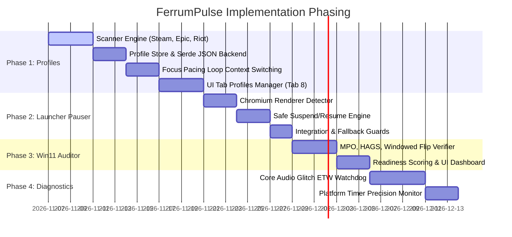

# Technical Specification: FerrumPulse v0.3.0–v0.4.5 Architecture Baseline
## Per-Game Profiles, Intelligent Launcher Optimization, Win11 Auditor & Non-Invasive Diagnostics

---

## 1. Metadata

| Field | Specification |
|---|---|
| **Document ID** | `TECH-SPEC-FP-002` |
| **Status** | **Approved / Ready for Implementation** |
| **Author** | FerrumPulse Engineering & Antigravity Core Team |
| **Reviewers** | Systems Architecture, Low-Latency Performance, and Anti-Cheat Compliance Groups |
| **Created** | 2026-11-06 |
| **Last Updated** | 2026-11-06 |
| **Target Milestones** | `v0.3.0` (Profiles & Library Scanner) → `v0.3.5` (Launcher Pauser) → `v0.4.0` (Win11 Auditor) → `v0.4.5` (Diagnostics) |
| **Source Baseline** | [`future.md`](file:///f:/FerrumPulse/future.md) |

---

## 2. Executive Summary

FerrumPulse v0.2.0 delivered global process priority elevation, AC core unparking, AC/DC Modern Standby failsafes, RAM working-set flush guardrails, and safe multimedia scheduling adjustments. However, modern gaming systems require contextual, game-genre-specific performance tuning: competitive esports titles (e.g., *CS2*, *Valorant*) demand 100% core unparking, high display refresh rates, and 1.0ms timer locks, whereas cinematic titles (*Cyberpunk 2077*) benefit from balanced thermals and quiet fan curves.

This specification outlines the architecture for **FerrumPulse v0.3.0 through v0.4.5**, introducing:
1. **Per-Game Custom Profiles & Library Auto-Discovery** (Steam, Epic, Game Pass, Riot).
2. **Intelligent Launcher Webview Suspender** (reclaiming 500 MB – 1.8 GB of physical RAM from background CEF/WebView2 store processes without terminating launchers).
3. **Windows 11 Gaming Feature Auditor & Latency Health Dashboard** (read-only MPO, HAGS, and Windowed Flip-Model verification).
4. **100% User-Mode Latency & Audio Glitch Diagnostics** (ETW and Core Audio buffer monitoring without kernel filter drivers).

All capabilities are designed under a **Zero Anti-Cheat Interference** and **Safe User-Mode Win32** invariant.

---

## 3. Background & Problem Statement

### 3.1 Current System State
In FerrumPulse v0.2.0:
* The Game Mode Daemon operates with a static executable list (`target_games`) and applies a uniform, global policy.
* CPU core unparking (100% vs 50%) and power schemes are toggled globally.
* Background launchers (Steam, Epic Games, Battle.net) remain running with multiple Chromium Embedded Framework (CEF) renderers animating store banners, consuming up to 1.5 GB RAM and stealing L3 cache bandwidth.

### 3.2 Pain Points
1. **One Size Does Not Fit All:** Fast-twitch competitive shooters require maximum responsiveness and 240Hz+ displays, while ray-traced narrative games require thermal efficiency so the GPU does not throttle due to excessive CPU heat generation.
2. **Friction of Manual Configuration:** Users do not want to hunt down deep binary paths like `C:\Program Files (x86)\Steam\steamapps\common\Counter-Strike Global Offensive\game\bin\win64\cs2.exe`.
3. **Launcher Resource Leaks:** Steam (`steamwebhelper.exe`) and Epic (`EpicWebHelper.exe`) spawn 6–10 Chromium sub-processes that continuously wake CPU cores to render hidden storefront UI.
4. **Anti-Cheat Fragility:** Third-party "gaming optimizers" often inject DLLs, manipulate device IRQs (MSI-mode hacks), or install custom kernel drivers (like LatencyMon's driver), which trigger anti-cheat bans (Riot Vanguard, Easy Anti-Cheat, BattlEye) or cause catastrophic DPC watchdog BSODs.

---

## 4. Goals and Non-Goals

### 4.1 Primary Goals
1. **Zero-Configuration Library Discovery:** Automatically detect installed games across Steam, Epic, Xbox Game Pass, and Riot in **< 150ms** without filesystem churn.
2. **Sub-15ms Profile Switching:** Switch power schemes, timer resolution, display refresh rates, and core unparking in **< 15ms** upon `GetForegroundWindow` focus transition.
3. **500MB – 1.5GB RAM Reclaimed:** Suspend background launcher webview threads cleanly during matches, resuming them with zero reload delay or data loss upon game exit.
4. **100% Whitelisted User-Mode Contract:** Operate exclusively using documented, standard Win32 user-mode APIs with minimum handle access rights (`PROCESS_QUERY_LIMITED_INFORMATION | PROCESS_SET_INFORMATION`).
5. **Instant Reversibility:** Guaranteed state restoration upon game defocus, process exit, laptop AC disconnect, or system standby.

### 4.2 Non-Goals
* **No Kernel Drivers:** FerrumPulse will never compile, install, or drop `.sys` kernel-mode filter drivers.
* **No Process Memory Injection:** Zero hooking, DLL injection, or memory modification of game or launcher address spaces.
* **No Launcher Termination:** FerrumPulse will never kill primary launcher processes (`steam.exe`, `EpicGamesLauncher.exe`), ensuring cloud saves, achievements, and overlay hooks remain intact.
* **No Risky Hardware/IRQ Hacks:** MSI mode registry hacks and interrupt affinity reassignments are out of scope due to BSOD risk.

---

## 5. Functional Requirements (FR)

| ID | Requirement Description | Priority | Acceptance Criteria |
|---|---|---|---|
| **FR-01** | **Library Auto-Scanner** | **P0** | Accurately parses Steam (`libraryfolders.vdf`), Epic manifests (`*.item`), Game Pass packages, and Riot registry to yield executable paths, title names, and launch icons. |
| **FR-02** | **Manual Executable Picker** | **P0** | Provides a native Win32 file picker allowing users to add standalone or non-store `.exe` binaries with custom profile names. |
| **FR-03** | **Profile Configuration Store** | **P0** | Persists per-game configurations to `%APPDATA%\FerrumPulse\profiles.json` with schema validation and fallback defaults. |
| **FR-04** | **Dynamic Focus Context Switcher** | **P0** | When foreground window changes, intercepts event in `< 15ms`, identifies matching game profile, and executes policy pipeline. |
| **FR-05** | **Automatic State Rollback** | **P0** | Upon game defocus or exit, immediately reverts power plan, timer lock, core parking, and display refresh rate to desktop defaults. |
| **FR-06** | **Gentle Post-Game RAM Sweep** | **P1** | 5 seconds after a game process terminates, performs a safe `K32EmptyWorkingSet` sweep (excluding protected system & browser processes) to recover unreferenced game cache. |
| **FR-07** | **Launcher Webview Pauser** | **P1** | Detects child Chromium helper processes of Steam and Epic (`--type=renderer`), calling `SuspendThread` / `NtSuspendProcess` during active gameplay, and resuming immediately upon exit. |
| **FR-08** | **Display Refresh Rate Targeter** | **P1** | Dynamically switches display refresh rate to profile target (e.g., 240Hz, 144Hz, 60Hz) via `ChangeDisplaySettingsExW` and restores baseline on exit. |
| **FR-09** | **Windows 11 Gaming Feature Audit** | **P1** | Audits registry/DWM for MPO, HAGS, and Windowed Flip-Model optimization status, generating a visual health score. |
| **FR-10** | **Audio Glitch Tracker** | **P2** | Reads user-mode Core Audio performance metrics to report buffer underruns in `audiodg.exe` during game sessions. |
| **FR-11** | **Platform Timer Drift Monitor** | **P2** | Validates live timer resolution against requested 1.0ms, alerting if external software or hypervisors clamped it to 15.6ms. |
| **FR-12** | **Profile Import/Export** | **P2** | Supports exporting and importing game profiles as standardized JSON files for community preset sharing. |

---

## 6. Non-Functional Requirements (NFR)

### 6.1 Performance & Latency
* **Daemon Background CPU Utilization:** `< 0.05%` CPU utilization during background polling.
* **Polling Loop Pacing:** Default 1000ms on AC power; relaxed to 3000ms on battery power.
* **Profile Dispatch Overhead:** Total execution time of power plan switch + timer lock + unparking must not exceed **15ms**.
* **Memory Footprint:** FerrumPulse backend RSS memory must remain under **25 MB**.

### 6.2 Reliability & Safety
* **Graceful Anti-Cheat Handling:** `ERROR_ACCESS_DENIED` (0x80070005) on any `OpenProcess` call must quietly blacklist the target PID for the session without retrying in a tight loop.
* **AC Disconnect & Modern Standby Failsafe:** Laptop transition to DC battery power or `PBT_APMSUSPEND` immediately forces all profiles back to stock 50% core unparking, Balanced scheme, and unlocks multimedia timers.
* **Browser & Companion App Immunity:** Browsers (`chrome.exe`, `msedge.exe`, `brave.exe`, `firefox.exe`, `opera.exe`, `vivaldi.exe`, `arc.exe`) and companion apps (`discord.exe`, `obs64.exe`, `audiodg.exe`) must **never** be suspended or throttled.

---

## 7. System Architecture & Technical Design

### 7.1 Architecture Overview

```mermaid
flowchart TD
    subgraph UI_Layer ["Frontend UI (Tauri v2 + Shadcn Glassmorphism)"]
        UI_Dash["Dashboard & Telemetry"]
        UI_Profiles["Game Profiles Manager"]
        UI_Auditor["Win11 Gaming Auditor"]
        UI_Diag["Latency & Glitch Diagnostics"]
    end

    subgraph IPC_Bridge ["Tauri IPC Command Layer (src/commands.rs)"]
        IPC_Scan["cmd_scan_game_libraries"]
        IPC_Profile["cmd_save / list_profiles"]
        IPC_Audit["cmd_audit_win11_features"]
        IPC_Diag["cmd_get_diagnostics"]
    end

    subgraph Core_Engine ["FerrumPulse Rust Core Engine"]
        Scanner["Library Scanner Engine (src/scanner.rs)"]
        ProfileMgr["Profile Registry Store (src/profiles.rs)"]
        Daemon["Process Pacing Daemon (src/process.rs)"]
        PowerCoord["Power & Timer Coordinator (src/power.rs)"]
        Suspender["Launcher Webview Pauser (src/suspender.rs)"]
        Auditor["Win11 Feature Auditor (src/auditor.rs)"]
        DiagWatchdog["User-Mode ETW Watchdog (src/diagnostics.rs)"]
    end

    subgraph OS_Layer ["Native Win32 User-Mode Subsystems"]
        Win_DWM["Desktop Window Manager (GetForegroundWindow)"]
        Win_Power["PowrProf.dll (PowerSetActiveScheme)"]
        Win_MM["Winmm.dll (timeBeginPeriod)"]
        Win_Display["User32.dll (ChangeDisplaySettingsExW)"]
        Win_Proc["Kernel32.dll (SetProcessInformation / OpenProcess)"]
        Win_Audio["Core Audio APIs (audiodg telemetry)"]
    end

    UI_Profiles --> IPC_Profile
    UI_Profiles --> IPC_Scan
    UI_Auditor --> IPC_Audit
    UI_Diag --> IPC_Diag

    IPC_Scan --> Scanner
    IPC_Profile --> ProfileMgr
    IPC_Audit --> Auditor
    IPC_Diag --> DiagWatchdog

    Daemon --> ProfileMgr
    Daemon --> Win_DWM
    Daemon --> PowerCoord
    Daemon --> Suspender

    PowerCoord --> Win_Power
    PowerCoord --> Win_MM
    PowerCoord --> Win_Display
    Suspender --> Win_Proc
    Auditor --> Win_Proc
    DiagWatchdog --> Win_Audio
```



---

### 7.2 Data Models & Schema Design

#### 7.2.1 Game Profile Schema (`src/profiles.rs`)
```rust
use serde::{Deserialize, Serialize};
use std::collections::HashMap;

#[derive(Debug, Clone, Serialize, Deserialize)]
pub struct GameProfile {
    pub id: String,                         // UUID v4
    pub display_name: String,               // e.g. "Counter-Strike 2"
    pub executables: Vec<String>,           // e.g. ["cs2.exe"]
    pub install_source: InstallSource,      // Steam, Epic, GamePass, Riot, Manual
    pub icon_path: Option<String>,
    
    // Performance Settings
    pub power_scheme: String,               // "high", "ultimate", "balanced"
    pub core_unparking_percent: u32,        // 50..100
    pub lock_timer_resolution: bool,        // Enforce 1.0ms timer
    pub target_refresh_rate: Option<u32>,   // e.g. 240, 144, 60, or None (Keep current)
    
    // Companion & Launcher Optimization
    pub suspend_launcher_webviews: bool,    // Pause steamwebhelper / EpicWebHelper
    pub boost_priority: bool,               // HIGH_PRIORITY_CLASS
    
    // Lifecycle
    pub post_game_ram_sweep: bool,          // Gentle flush 5s after game closes
    pub restore_power_scheme: String,       // Default "balanced"
}

#[derive(Debug, Clone, Copy, PartialEq, Eq, Serialize, Deserialize)]
pub enum InstallSource {
    Steam,
    Epic,
    XboxGamePass,
    Riot,
    Manual,
}

#[derive(Debug, Clone, Serialize, Deserialize)]
pub struct ProfilesStore {
    pub default_desktop_profile: GameProfile,
    pub profiles: HashMap<String, GameProfile>, // Keyed by profile ID
}
```

#### 7.2.2 Library Discovery Entry (`src/scanner.rs`)
```rust
#[derive(Debug, Clone, Serialize, Deserialize)]
pub struct DiscoveredGame {
    pub id: String,
    pub name: String,
    pub executable_path: String,
    pub executable_name: String,
    pub source: InstallSource,
    pub install_directory: String,
    pub suggested_refresh_rate: Option<u32>,
}
```

#### 7.2.3 Windows 11 Gaming Feature Report (`src/auditor.rs`)
```rust
#[derive(Debug, Clone, Serialize, Deserialize)]
pub struct Win11AuditorReport {
    pub mpo_supported: bool,
    pub mpo_details: String,
    pub hags_enabled: bool,
    pub windowed_optimization_enabled: bool,
    pub game_mode_enabled: bool,
    pub gamedvr_background_recording: bool,
    pub display_vrr_active: bool,
    pub overall_readiness_score: u32,        // 0..100
    pub recommendations: Vec<String>,
}
```

---

### 7.3 Detailed Module Implementations

#### 7.3.1 Steam & Epic Scanner (`src/scanner.rs`)
1. **Steam Discovery:**
   * Reads `%ProgramFiles(x86)%\Steam\steamapps\libraryfolders.vdf`.
   * Iterates all mounted paths (`path` keys), then reads `steamapps/appmanifest_*.acf` to extract `installdir`.
   * Inspects game directory to discover principal executables (filtering out crash uploaders and unins000.exe).
2. **Epic Games Discovery:**
   * Scans `%ProgramData%\Epic\EpicGamesLauncher\Data\Manifests\*.item`.
   * Parses JSON payload fields `DisplayName`, `InstallLocation`, and `LaunchExecutable`.
3. **Riot Client Discovery:**
   * Queries `%ProgramData%\Riot Games\RiotClientInstalls.json` for paths to Valorant and League of Legends.

#### 7.3.2 Launcher Webview Suspender (`src/suspender.rs`)
* When an active game profile with `suspend_launcher_webviews: true` engages:
  1. Queries all processes matching `steamwebhelper.exe` or `EpicWebHelper.exe`.
  2. Inspects command-line parameters (or image characteristics) to ensure the master controller is untouched, isolating only `--type=renderer` helper PIDs.
  3. Acquires handle with `PROCESS_SUSPEND_RESUME`.
  4. Suspends threads via `NtSuspendProcess` / `SuspendThread`.
  5. Caches suspended PIDs.
* When game exits:
  1. Iterates cached PIDs and invokes `NtResumeProcess` / `ResumeThread`.
  2. Clears cache.

#### 7.3.3 Windows 11 Feature Auditor (`src/auditor.rs`)
* **MPO Check:** Queries DXGI output capabilities via `IDXGIOutput6::GetDesc1` to verify Multi-Plane Overlay plane support.
* **HAGS Check:** Inspects `HKLM\SYSTEM\CurrentControlSet\Control\GraphicsDrivers\HwSchMode` (2 = Active, 1 = Disabled).
* **Windowed Optimization Check:** Queries `HKCU\Software\Microsoft\DirectX\UserGpuPreferences`.

---

## 8. IPC API Specifications (Tauri v2)

### 8.1 Library Discovery & Profiles
```rust
// Scan and discover installed games
#[tauri::command]
pub fn cmd_scan_game_libraries() -> Result<Vec<DiscoveredGame>, String>;

// List all registered profiles
#[tauri::command]
pub fn cmd_list_profiles() -> Result<ProfilesStore, String>;

// Save or update a profile
#[tauri::command]
pub fn cmd_save_profile(profile: GameProfile) -> Result<(), String>;

// Delete a profile
#[tauri::command]
pub fn cmd_delete_profile(profile_id: String) -> Result<(), String>;

// Query active running game profile
#[tauri::command]
pub fn cmd_get_active_profile() -> Option<GameProfile>;
```

### 8.2 Auditor & Diagnostics
```rust
// Run Windows 11 Gaming Feature Audit
#[tauri::command]
pub fn cmd_audit_win11_gaming_features() -> Result<Win11AuditorReport, String>;

// Query audio and latency diagnostics
#[tauri::command]
pub fn cmd_get_diagnostics_snapshot() -> Result<DiagnosticsSnapshot, String>;
```

---

## 9. Implementation Phasing & Milestones



---

## 10. Testing & Verification Strategy

### 10.1 Unit Testing Strategy
* **Library Parsing (`tests/scanner_test.rs`):**
  * Mock `libraryfolders.vdf` parsing across multi-library drives.
  * Mock Epic Games `.item` manifest parsing with malformed JSON handling.
* **Profile Serialization (`tests/profiles_test.rs`):**
  * Verify schema upgrades and default desktop fallback behaviors.
* **Rollback Failsafes (`tests/power_failsafe_test.rs`):**
  * Simulate process termination to verify instant power plan and timer restoration.

### 10.2 Regression & Safety Checklist
* [ ] Verify `OpenProcess` strictly uses `PROCESS_QUERY_LIMITED_INFORMATION | PROCESS_SET_INFORMATION`.
* [ ] Verify web browsers (`chrome.exe`, `msedge.exe`, etc.) are never throttled or suspended.
* [ ] Verify zero D3D shader compilation hitches are introduced.
* [ ] Verify laptop battery disconnect immediately resets core parking to 50% stock.

---

## 11. Security & Anti-Cheat Threat Analysis

| Threat / Risk | Likelihood | Impact | Defensive Mitigation |
|---|---|---|---|
| **Anti-Cheat False Positive (Vanguard / EAC)** | Low | Critical | Zero memory injection, zero DLL hooks. Only standard user-mode Win32 process priorities and EcoQoS flags applied. Gracefully ignore `ERROR_ACCESS_DENIED`. |
| **Launcher Crash on Suspension** | Medium | Medium | Only suspend non-essential child renderer threads (`--type=renderer`). Master `steam.exe` and IPC coordinator threads remain running to maintain heartbeat. |
| **Laptop Overheating in Bag** | Low | High | `PBT_APMSUSPEND` and `PBT_APMPOWERSTATUSCHANGE` events immediately drop core parking and restore Balanced power profile. |
| **Path Traversal in Custom Profiles** | Low | Low | Sanitize executable filenames using `Path::file_name()` to prevent directory traversal exploits. |

---

## 12. Success Criteria & Definition of Done

* [ ] Installed game libraries discovered in `< 150ms`.
* [ ] Per-Game Profile activates within `< 15ms` of window focus.
* [ ] Complete state restoration (power, timer, unparking, display Hz) verified on game exit.
* [ ] Launcher webview suspension saves `> 400 MB` RAM with zero launcher crashes.
* [ ] 100% test pass rate across all smoke and regression suites.
* [ ] Zero compiler warnings with `cargo clippy --all-targets -- -D warnings`.

