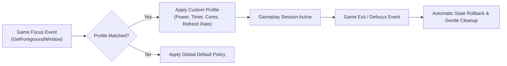
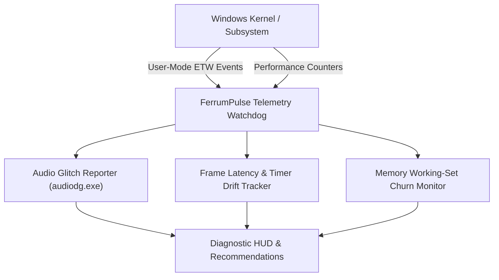

# FerrumPulse — Future Roadmap & Architecture Baseline (`future.md`)

> **Guiding Principle:** Safe, Non-Invasive, Anti-Cheat Whitelisted Optimizations.  
> Every feature must operate strictly through documented Win32 user-mode APIs, avoiding kernel driver injection, raw interrupt manipulations (MSI-mode hacks), or aggressive system modifications that could cause BSODs, system instability, or anti-cheat false positives (Vanguard, Easy Anti-Cheat, BattlEye).

---

## Executive Summary

FerrumPulse v0.2.0 established the core engine: dynamic process priority pacing, AC min core unparking, AC/DC Modern Standby failsafes, RAM working-set flush guardrails, and safe multimedia scheduling adjustments. 

This document defines the strategic roadmap for subsequent releases, establishing a baseline for feature specifications, technical boundaries, and UI architectures.

---

## 🏛️ Pillar 1: Per-Game Custom Profiles & Library Auto-Discovery

### 1.1 Overview
Currently, FerrumPulse applies global policies (e.g., global game boost and background throttling). Per-Game Profiles allow users to customize performance policies tailored to individual game genres (e.g., hyper-competitive esports vs. cinematic single-player RPGs).



### 1.2 Library Auto-Discovery
Instead of requiring manual executable path entry, FerrumPulse will automatically discover installed game titles:
* **Steam:** Parse `libraryfolders.vdf` and `appmanifest_*.acf` across all drive mounts to locate game directories and primary binaries.
* **Epic Games:** Inspect `%PROGRAMDATA%\Epic\EpicGamesLauncher\Data\Manifests\*.item` to extract display names and executable paths.
* **Xbox / PC Game Pass:** Query Win32 Package Manager (`Get-AppxPackage`) for installed GamingServices titles.
* **Riot Games:** Read install locations from `%PROGRAMDATA%\Riot Games\RiotClientInstalls.json`.
* **Manual Picker:** Native file picker dialog for non-store / standalone `.exe` binaries.

### 1.3 Profile Parameters
Each game profile supports granular configuration:

```json
{
  "profile_name": "Counter-Strike 2",
  "executables": ["cs2.exe"],
  "power": {
    "scheme": "high",
    "core_unparking_percent": 100,
    "lock_1ms_timer": true
  },
  "display": {
    "target_refresh_rate_hz": 240,
    "auto_restore_on_exit": true
  },
  "companion_apps": {
    "suspend_launcher_webviews": true,
    "exempt_voice_apps": ["discord.exe", "ts3client_win64.exe"]
  },
  "lifecycle": {
    "post_exit_ram_cleanup": true,
    "post_exit_restore_plan": "balanced"
  }
}
```

### 1.4 Automatic Lifecycle Rollback
When the game process exits or loses focus:
1. Reverts CPU core unparking to default stock levels (50%).
2. Switches power scheme back to the user's preferred desktop baseline (Balanced).
3. Relinquishes `timeBeginPeriod(1)` timer locks.
4. Restores standard desktop display refresh rate.
5. Performs a safe, non-invasive working-set memory sweep after a 5-second cooldown to reclaim caches leftover from the closed game.

---

## 🚀 Pillar 2: Intelligent Launcher & Webview Suspender

### 2.1 The Problem
Modern game launchers (Steam, Epic Games Store, Battle.net, EA Desktop) run multiple background Chromium Embedded Framework (CEF) or WebView2 instances (`steamwebhelper.exe`, `EpicWebHelper.exe`). These processes:
* Consume between **500 MB and 1.8 GB of physical RAM**.
* Continually render background animated store banners, trailers, and telemetry loops.
* Compete for cache and CPU cycles on modern hybrid CPUs (spilling onto P-cores or polluting E-cores).

### 2.2 The Non-Invasive Solution
FerrumPulse will **never kill or terminate launchers**, preserving cloud saves, friends lists, in-game overlays, and anti-cheat hooks. Instead:
* **Targeted Webview Suspension:** When a game starts, FerrumPulse targets only non-essential renderer helper child PIDs (e.g., `steamwebhelper.exe --type=renderer`) and gently pauses their execution threads via `NtSuspendProcess` / `SuspendThread` (or clamps them to maximum EcoQoS efficiency mode).
* **Instant Resume on Game Exit:** When the game closes, threads are immediately resumed (`NtResumeProcess`). The user returns to their launcher with zero crashes, reload delays, or lost session states.

---

## 🔍 Pillar 3: Windows 11 Gaming Feature Auditor & Health Dashboard

### 3.1 Overview
Windows 11 includes numerous gaming optimizations that are frequently disabled by corrupted updates, OEM preloads, or conflicting software. FerrumPulse will provide a read-only audit dashboard that grades system readiness without touching sensitive drivers.

### 3.2 Audit Checkpoints
1. **Multi-Plane Overlay (MPO) Status:**
   * Validates whether Desktop Window Manager (DWM) supports hardware multi-plane overlays, enabling true windowed borderless presentation without VSync latency penalties.
2. **Optimizations for Windowed Games (DXGI Flip Model):**
   * Inspects `HKCU\Software\Microsoft\DirectX\UserGpuPreferences` to check if modern DXGI flip-model presentation is enabled for legacy DirectX 10/11 titles.
3. **Hardware-Accelerated GPU Scheduling (HAGS):**
   * Inspects `HKLM\SYSTEM\CurrentControlSet\Control\GraphicsDrivers\HwSchMode` (2 = Enabled) and reports whether the GPU kernel scheduler directly manages its own VRAM and queue.
4. **Auto-HDR & Variable Refresh Rate (VRR) State:**
   * Reads Windows display subsystem telemetry to report whether VRR (G-Sync/FreeSync) and Auto-HDR are properly engaged on primary gaming displays.
5. **System Health & Advisory Score:**
   * Synthesizes findings into a clear visual checklist with explanations of how each setting impacts input latency, frame pacing, and micro-stutters.

---

## 📊 Pillar 4: Non-Invasive Latency & Glitch Diagnostics

### 4.1 Safe Diagnostics Philosophy
Kernel drivers or third-party filter drivers (like LatencyMon) can cause instability or conflict with anti-cheat software like Riot Vanguard. FerrumPulse will implement **100% user-mode, read-only diagnostic telemetry**:



### 4.2 Diagnostic Capabilities
1. **Audio Engine Buffer Underrun Tracker:**
   * Monitors Windows Core Audio (`audiodg.exe`) buffer health. Detects if background CPU spikes caused dropped audio samples or microphone crackle during gaming.
2. **High-Precision Scheduler Timer Drift Monitor:**
   * Measures actual platform timer precision over time, alerting users if a background hypervisor or background application has degraded the 1.0ms timer target back to 15.6ms.
3. **Memory Pressure & Churn Alarm:**
   * Warns the user when physical RAM exceeds 88% capacity *before* Windows initiates aggressive emergency paging file write-backs that induce multi-second micro-stutters.

---

## 🛡️ Anti-Cheat & Safety Invariants (Baseline Guarantee)

To maintain total safety, the following invariants are permanently established:
1. **Zero DLL Injection:** FerrumPulse will never inject DLLs or hook memory spaces of running processes.
2. **Minimal Handle Privileges:** Calls to `OpenProcess` must request only standard query and state rights (`PROCESS_QUERY_LIMITED_INFORMATION | PROCESS_SET_INFORMATION`).
3. **Protected Process Whitelist:** Web browsers, voice chat (`discord.exe`), broadcasting software (`obs64.exe`), and core OS subsystems (`audiodg.exe`, `dwm.exe`, `explorer.exe`) must never be throttled or flushed.
4. **AC/DC & Sleep Safety:** On transition to battery power or Modern Standby (`PBT_APMSUSPEND`), all performance overrides revert instantly to preserve battery life and prevent laptop overheating.
5. **One-Click Reversibility:** Every single tweak, profile, and policy modification must have a documented, instant stock Windows restore path.

---

## 📅 Roadmap Phasing

| Phase | Milestone | Primary Deliverables | Safety Level | Status |
|---|---|---|---|---|
| **Phase 1** | **v0.3.0 — Per-Game Profiles** | Steam/Epic auto-discovery, custom per-game profile manager, auto-switching daemon. | 🟢 100% Safe User-Mode | ✅ Completed (`v14`) |
| **Phase 3** | **v0.4.0 — Win11 Gaming Auditor** | Read-only MPO, HAGS, Windowed Optimization checklist & latency health score. | 🟢 100% Read-Only | ✅ Completed (`v15`) |
| **Phase 2** | **v0.5.0 — Latency & Stutter Benchmarker** | 15s DPC execution spike testing, QPC timer jitter, and CoreAudio buffer health. | 🟢 100% Read-Only NTDLL | ✅ Completed (`v16`) |
| **Phase 4** | **v0.6.0 — Network QoS & Packet Pacing** | Per-game DSCP 46 tagging, Nagle algorithm disabling, ping & jitter diagnostic. | 🟢 100% Safe User-Mode | ✅ Completed (`v18`) |
| **Phase 5** | **v0.7.0 — Launcher Webview Suspender & Workbench** | Targeted `--type=renderer` suspension with Smart Resume, inline profile editor, native `.exe` picker, Import/Export & zero-churn daemon. | 🟢 100% Safe User-Mode | ✅ Completed (`v19`) |
| **Phase 6** | **v0.8.0 — Audio, Laptop S0ix & Deep Scanner** | `audiodg.exe` core pinning, silent WASAPI glitch probe, Tab 6 BatteryConfig + AC Hz restore, S0ix power overlay, deep UE5/Xbox scanner & 88% RAM guardrail. | 🟢 100% Safe User-Mode | ✅ Completed (`v20`) |

---

*This document serves as the project baseline for future architecture, feature planning, and design decisions.*

